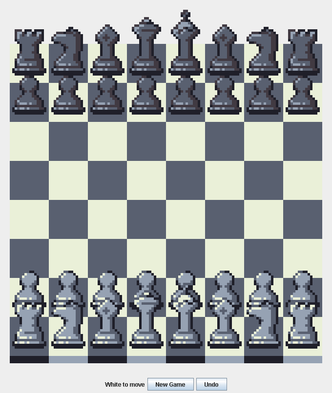
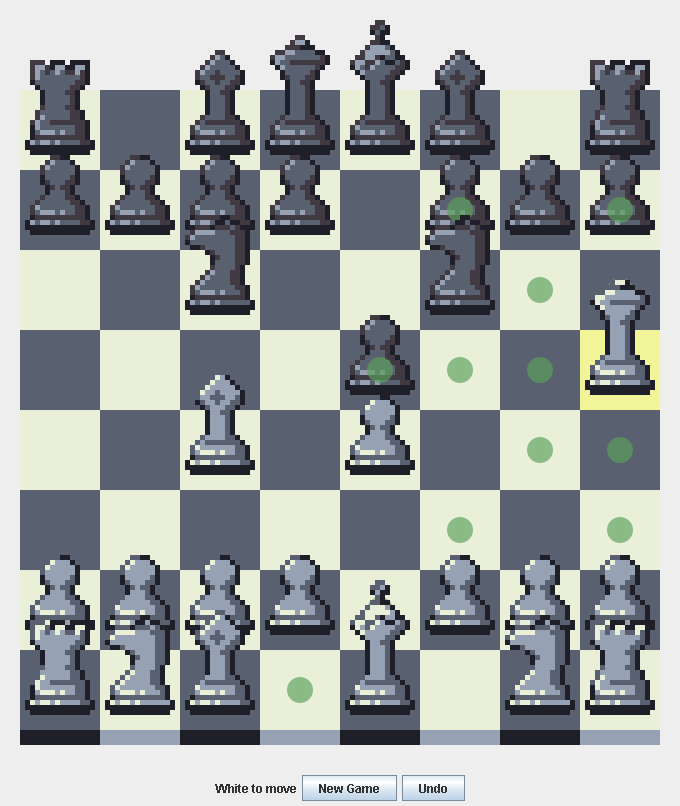
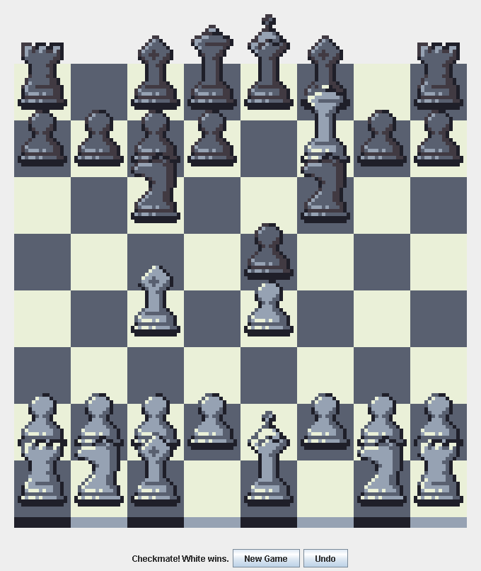

<div align="center">


# OOPs Chess

**A two-player chess game written in plain Java and Swing.**

I made this for my Object-Oriented Programming course. The goal was to practise OOP in Java
on something bigger than a textbook exercise, so the rules, the move generation and the
check detection were all written by hand, with no chess libraries.

<br>



</div>

## What it does

Two players share the same window and take turns. Click a piece to select it and the squares it can legally move to are marked with a dot. Click one of those squares to move there.

- Only legal moves are allowed. A move that would leave your own king in check is rejected, so pinned pieces stay pinned.
- The game detects check, checkmate and stalemate and shows it in the status bar.
- Pawns that reach the last rank become a queen.
- **Undo** takes back the last move and **New Game** resets the board.
- Pieces and the board are pixel art, loaded from the `assets` folder.

<table>
  <tr>
    <td align="center"></td>
    <td align="center"></td>
    <td align="center"></td>
  </tr>
  <tr>
    <td align="center">Starting position</td>
    <td align="center">Legal moves for the queen</td>
    <td align="center">Checkmate</td>
  </tr>
</table>

## How the OOP side is set up

Most of the project is about how the classes fit together, so here is the short version.

| Concept | Where it shows up |
| --- | --- |
| Abstraction | `Piece` is an abstract class. It says every piece must be able to list its possible moves, but does not say how. |
| Inheritance | `Pawn`, `Rook`, `Knight`, `Bishop`, `Queen` and `King` all extend `Piece`. Shared helpers like `addSlidingMoves` and `addStepMoves` live in the parent. |
| Polymorphism | `Board` and `Game` just call `piece.getPossibleMoves(...)` on whatever is on the square. They never check which piece it is. |
| Encapsulation | The board grid, the move history and the current turn are private. Everything else goes through methods like `makeMove` and `undo`. |
| Enums | `PieceColor` and `GameStatus` keep the state readable instead of passing around strings or ints. |

The rest is split by responsibility:

- `Board` holds the 8x8 grid and answers questions like "is this square attacked?"
- `Game` owns the rules: whose turn it is, which moves are legal, the history used for undo, and the game status.
- `Move` and `Position` are small value classes.
- `BoardPanel` and `ChessFrame` are the Swing UI. They only talk to `Game`, so the logic does not depend on the UI at all.

## Running it

You need a JDK (8 or newer). Run the commands from the project folder, since the images are loaded from `assets/` using a relative path.

```
javac *.java
java Main
```

There is also a small text-mode demo that prints the board and some moves to the terminal:

```
java ConsoleDemo
```

## Tests

`ChessTest` runs a few positions through the rules without opening any window:

```
java ChessTest
```

```
PASS  White has exactly 20 legal moves at the start
PASS  Rook cannot jump over its own pawn
PASS  Cannot move Black's piece on White's turn
PASS  Pawn e2-e4 is allowed
PASS  It is now Black's turn
PASS  Undo puts the pawn back on e2
PASS  Undo gives the turn back to White
PASS  Before the last move: not mate yet
PASS  Fool's mate is CHECKMATE
PASS  Pinned rook cannot leave the e-file
PASS  Pinned rook CAN capture the attacker
PASS  Stalemate is detected

All tests passed.
```

## Not done yet

Castling and en passant are not implemented, and promotion always gives a queen. Draws by repetition or the fifty-move rule are not checked either.

## Project layout

```
oops-chess/
├── Main.java            starts the Swing window
├── ChessFrame.java      window, status bar and buttons
├── BoardPanel.java      draws the board and handles clicks
├── Game.java            turns, legal moves, undo, game status
├── Board.java           8x8 grid and attack checks
├── Piece.java           abstract base class for all pieces
├── Pawn.java, Rook.java, Knight.java, Bishop.java, Queen.java, King.java
├── Move.java, Position.java, PieceColor.java, GameStatus.java
├── ChessTest.java       rule tests
├── ConsoleDemo.java     text-mode demo
└── assets/              piece and board sprites
    └── readme/          screenshots and GIF used in this README
```
